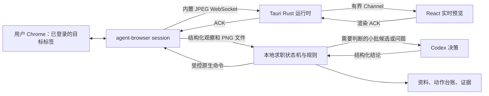

# JPEG 实时预览与低 token 求职执行设计

日期：2026-11-18。状态：原生运行时、JPEG/Channel、领域适配、小批 AI 决策和用量统计已实现；隔离 Chrome 已通过认证、标签、ACK 和正常后台窗口检查。真实 Chrome 已配对，真实 BOSS 的脚本模式、平台推荐 AI 模式、AI 精筛各一次开聊已记为 `greet=succeeded`，三轮任务全部暂停。五轮修复、独立审查及最终 D 盘安装核验完成；2,286 项资源核验一致。详见[五轮记录](../superpowers/plans/2026-11-18-agent-browser-iterations.md)。当前 beta.5 未发布，此前发布的 0.3.0-beta.4 仍按其旧扩展链路说明使用。

本方案落实用户最新要求：优先使用更合适的成熟工具，允许替换现有浏览器链路；不以兼容旧扩展或减少代码改动作为首要目标。采用 JPEG 帧流，保留网申、不同求职类型、规则投递、AI 精筛、消息规则、人工接管和真实截图记录。

## 1. 选型决定

浏览器基础设施采用 **agent-browser v0.43.0**。该正式版本提供 Windows 原生 CLI/daemon、连接现有 Chrome、标签绑定、元素 refs、结构化快照、脚本求值、批量命令、元素截图和 JPEG WebSocket 流。版本以[正式 Release](https://github.com/vercel-labs/agent-browser/releases/tag/v0.43.0)为基线，构建时再锁定源码提交、平台产物和 SHA-256，不跟随 latest。

本轮固定产物身份如下，发布时还需核对随包清单：

| 项目 | SHA-256 |
|---|---|
| canonical `agent-browser.exe` | `2468725141270ae787052fa13c3e6128d1c4ba06b6c0f8145703dd1dc9900c16` |
| 内嵌补丁 | `e32bdb24f6881b9dbe4a7500f0b9697fb8b1f197b88a1bb74811a13b4e3e859f` |

| 部分 | 采用方案 | 本项目负责的内容 |
|---|---|---|
| 浏览器连接与动作 | agent-browser 原生 CLI/daemon | 选择目标标签、限定业务动作、核对岗位和会话 |
| JPEG 采集、传输、背压 | agent-browser 内置 stream | 订阅、认证补丁、向界面交付、渲染 ACK |
| WebSocket 客户端 | Rust `tokio-tungstenite`，按需要使用 `futures-util` | 生命周期和消息限长，不手写 WebSocket |
| 界面 | 现有 Tauri 2、React、Tauri Channel | 实时预览、任务阶段、暂停接管、用量显示 |
| 确定性业务 | 本地规则和状态机 | 筛选、去重、计数、导航、话术、填写、截图、回执 |
| 需要理解的决策 | 现有 Codex 接入，受限领域工具 | 精筛或未知问题；不承担重复浏览器步骤 |
| 记录与材料 | 现有本地资料、SQLite 台账、PNG 证据 | 不迁移或重录用户材料，不清空历史 |

不同时引入 Playwright MCP、Stagehand、browser-use 作为生产浏览器控制器。它们不是本期必需依赖。Playwright CLI 可用于独立开发验证，agent-browser 官方 Skill 可用于开发调试；发行版直接调用固定原生程序，用户不需要先安装这些开发工具。

agent-browser 替换旧浏览器基础设施，求职业务仍由应用决定。快照里的 `@eN` 是元素引用，不是岗位、招聘者或消息的长期身份。

## 2. 总体结构



JPEG 不经过 Python，不经过 `WorkerClient::request`，不写入每帧临时文件，不进入模型上下文，也不触发全局业务状态刷新。Python 可继续承担领域服务；浏览器底座、帧服务和连接码协议由新工具替换。

保留受限求职工具入口，而不是把通用 shell、任意 JavaScript 或完整 CLI 命令交给模型。网站文字只作为数据，不得改变授权、安装依赖或扩展操作范围。

## 3. 浏览器连接与生命周期

### 3.1 主路径：复用现有 Chrome

1. 检查固定版原生程序、Chrome 版本和配对能力。
2. Chrome 144+ 在 `chrome://inspect/#remote-debugging` 开启远程调试并处理原生提示。生产入口复用官方 `--auto-connect` 的端点发现、握手验证及待审批诊断，不再自行读取 Chrome profile 端点。曾实测直接 WS 可连接，但缺少同等握手诊断；无需维护两套生产发现逻辑。内嵌补丁禁止首次发现过程新建空白标签。已有扩展连接不等于已经具备这个新连接条件。
3. 应用建立自己专属的 session，先只读列出标签，让用户选择 BOSS 标签，随后按 targetId 绑定。
4. 后续所有读取、动作、截图和预览都使用该 session 与绑定标签。
5. 绑定标签关闭后进入 `tab_gone`，暂停任务，不自动改控其他标签或新建替代页面。

官方命令能力示意，实际由程序参数数组调用，不复制为 shell 拼接：

```text
agent-browser --session <app-session> --auto-connect tab list --json
agent-browser --session <app-session> --pin-tab tab <targetId>
agent-browser --session <app-session> snapshot -i --json
```

首次直接使用 `--pin-tab` 且没有历史绑定可能新建标签，因此必须先列出并明确选择。不得用 `open URL` 覆盖未选择的现有标签。[固定版 CDP 文档](https://github.com/vercel-labs/agent-browser/blob/v0.43.0/docs/content/docs/cdp-mode.mdx)

### 3.2 后台窗口与后续备用路径

本机已实测：目标保持本窗口活动标签、正常窗口在应用后方时 JPEG 可持续，停 ACK 10 秒后恢复帧龄约 73 ms，未抢系统焦点。同窗口隐藏目标标签可停帧，最小化尚未通过验收。建议 BOSS 独立窗口并保持活动标签；不因用户切换其他标签就自动抢回。以下专属 profile 备用入口仍属设计，当前没有实现，不能展示为已可用。

无法使用现有 Chrome 配对时，提供应用专属 profile，打开可见浏览器，由用户登录一次。用户主动选择这个方式，不自动复制 Cookie、密码或 Chrome 资料目录，也不假装继承现有登录状态。

运行时记录浏览器所有权。外接 Chrome 调用 `close` 只断开本应用 session；自启浏览器可随 session 关闭。不能把一次短命 CLI 子进程当作后台 daemon；CLI 会派生 daemon，退出清理按专属 session 执行，不全局杀 Chrome。[固定版实现](https://github.com/vercel-labs/agent-browser/blob/v0.43.0/cli/src/native/browser.rs)

应用崩溃后重启使用新的专属 session/namespace 和新凭证，不直接连接丢失 token 的遗留 daemon。记录 session 所有权，只对确认属于本应用的残留 session 执行 `close`；身份不明或清理失败时记录待处理，禁止全局清理、杀用户 Chrome 或复用旧匿名端口。

### 3.3 授权域边界

v0.43.0 的 `--allowed-domains` 不允许与 `--auto-connect`、`--cdp`、`--profile`、`--restore`、`--state` 组合。本方案不能同时声称复用登录态和启用该工具的网络域沙箱。

复用现有 Chrome 时，应用在导航前、导航后和产生外部作用前核对目标域、目标标签和任务范围。它属于应用层动作约束，不是浏览器网络隔离。BOSS 仅授权指定 BOSS 页面；网申范围来自用户公司表。跨域登录、外部身份页或未知跳转应停在人工边界，不能直接把整个互联网加入范围。[固定版 Security](https://github.com/vercel-labs/agent-browser/blob/v0.43.0/docs/content/docs/security.mdx)

## 4. JPEG 实时流

### 4.1 直接使用工具已有协议

通过 `stream status --json` 发现当前 session 的实际端口，不固定写 9222 或某个预览端口。Rust 连接 agent-browser 的 localhost WebSocket；React 只接收 Tauri Channel，不直连原始端口。

采用原生 `frame`、`status`、`tabs`、`url` 等消息，不另外发明采集协议。JPEG/base64 透传到界面，不反复解码或重编码。React 使用 Image 解码后绘制 canvas，再确认该帧；没有引入远程网页嵌入或 Blob URL 生命周期。

当前实现配置如下；配置上限不是实际持续帧率的承诺：

| 参数 | 当前配置 |
|---|---|
| 订阅模式 | `pacing=ack` |
| 最大显示帧率 | 5 fps |
| JPEG 质量 | 65 |
| 缩放上限 | 宽 1280、高 900，保持比例，不改变网页布局 |
| 流连接 | 每个运行时仅一个预览消费者 |
| 在途帧 | 1 帧 |
| 待显示帧 | 仅最新一帧，禁止逐帧 FIFO |
| 单条媒体消息 | 2 MiB 上限，超限关闭订阅并提示 |
| 工作台隐藏 | 退订或停止预览采集；业务截图仍按需要执行 |

质量和尺寸使用该版本已提供的 `AGENT_BROWSER_STREAM_QUALITY`、`AGENT_BROWSER_STREAM_MAX_WIDTH`、`AGENT_BROWSER_STREAM_MAX_HEIGHT`，在 daemon 启动前配置。订阅用 `?pacing=ack&maxFps=5`，确保首帧也受设置约束。[固定版流协议](https://github.com/vercel-labs/agent-browser/blob/v0.43.0/skill-data/core/references/streaming.md)

### 4.2 ACK 与背压

agent-browser 已处理 Chrome 的 `Page.screencastFrameAck`，应用不再实现或干预这层 ACK。

React 解码并提交当前帧供显示后，将该帧 `seq` 交给 Rust，由 Rust确认给 agent-browser。Rust 收到数据不等于前端已经显示，不能在收帧时提前确认。Channel 回调不做磁盘、模型调用或业务刷新。前端解码失败应确认丢弃或结束当前订阅，避免永久占住在途帧。

Rust 层发现超限或格式错误时关闭连接并标记预览失败，不直接丢弃而一直等待前端 ACK。前端解码失败时确认丢弃或结束订阅。降低 daemon 启动时的质量/尺寸配置需受控重建 session，不无限重连原样超限流。

每次连接、切换目标或重新订阅增加应用自己的 `stream_epoch`；前端仅接受当前 epoch。工具的 `seq` 只用于媒体排序/ACK，不能作为岗位内容版本、动作授权或成功回执。

静止页面可能没有新帧。用 WebSocket 存活探测、工具状态和按需观察判定连接，不仅按“最近一张 JPEG 的年龄”判离线。休眠恢复、daemon 重启或标签消失时显示断开原因，不显示旧画面仍在执行。

### 4.3 原始服务入口补丁

固定版基础 stream 没有 token 认证或只读开关；其 `input_*` 直接进入 CDP，不受普通 ActionPolicy 覆盖；同一 listener 还提供 HTTP 命令入口。只在 UI 隐藏按钮或外面套代理，无法保护仍开放的原始端口。[固定版 WebSocket 实现](https://github.com/vercel-labs/agent-browser/blob/v0.43.0/cli/src/native/stream/websocket.rs)、[HTTP 实现](https://github.com/vercel-labs/agent-browser/blob/v0.43.0/cli/src/native/stream/http.rs)

当前维护范围很小、独立测试的内嵌补丁：

- 在原始 listener 入口统一验证父进程生成的随机 Bearer token，覆盖 WebSocket 与相关 HTTP 路由；嵌入模式拒绝不需要的 HTTP 命令接口。
- 首版预览只读，拒绝 `input_mouse`、`input_keyboard`、`input_touch`，保留 `config`、`ack`。
- token 仅存在本机运行时内存/受控启动环境，不进入网页、模型、预览前端、日志或发布资源。daemon 重建后轮换。
- 继续使用工具原有采集、latest-frame 和 ACK 实现，不重写流服务。

补丁专用配置为 `JOB_ASSISTANT_EMBEDDED=1` 与本机内存中的 `JOB_ASSISTANT_STREAM_TOKEN`，并非上游原有参数。CLI 本机命令入口同样验证凭证；连接后的命令使用 `JOB_ASSISTANT_EXISTING_DAEMON=1`，daemon 不存在或不匹配时拒绝，不静默重建。认证、输入限制与绕过检查已完成；真实开聊的通过范围见本文件开头。人工接管首版直接暂停任务并切回原 Chrome。

嵌入模式缺少 token 时拒绝启动 listener，不能退回匿名模式。每次 daemon 重建重新注入凭证并执行补丁能力探针；若发现未打补丁的程序或旧匿名 session，停止连接，不降级。通过新连接 epoch 拒绝旧帧和旧 ACK。

## 5. 脚本定位岗位与截图

### 5.1 读取与定位

本地 BOSS 适配逻辑通过 agent-browser 的结构化快照、`snapshot -i --json` 和固定只读 `eval --stdin` 提取所需事实：岗位标识、真实链接、名称、公司、城市、类型、薪资原文、标签、沟通状态和详情。优先批量读取当前已加载卡片；滚动后按岗位标识增量去重。虚拟列表尚未渲染的岗位不能算已扫描。

`snapshot -i` 主要覆盖交互元素，不能替代岗位正文。详情文字通过指定区域读取；不要把全站 HTML、整棵树、全部联系人或最后 18000 字的页面 body 都回传模型。

第五轮实测修复了详情外层容器混入动态页脚的问题：它曾让模型接受后的复核反复进入 `changed_return`。现仅以职位描述区域和岗位标签构造详情事实，完整保留 JD，不按字符截断。实测同一岗位的外层文本为 1778 字符，完整 JD 为 325 字符，包含全部 7 条要求，两次导航后保持一致；真正参与判断的岗位事实改变时仍阻断发送。

refs 仅在当前有效页面观察中使用，导航或节点替换后重新观察。长期去重使用岗位标识、公司和真实链接，不保存 `@eN` 作为岗位身份。脚本模板和选择器由应用维护；网页字段只作为数据，不拼成可执行 JS。

### 5.2 内容就绪

打开详情后检查：目标身份一致，标题与公司匹配，必要正文存在，加载状态结束，目标区域可见且布局稳定。以这些条件和超时上限控制，不依赖固定 sleep 或整站 networkidle。原型可用短去抖辅助布局稳定判断，但去抖本身不能证明内容完整。

就绪失败记录原因，不发送。读取失败、空文本、未展开段落不能被当成“该要求不存在”。

### 5.3 元素截图与证据

使用工具已有的元素截图能力，如 `screenshot @e1` 或指定受控选择器与文件路径；PNG 为默认格式。避免自建图片裁剪管道，具体参数以固定版能力探针为准。[固定版截图命令解析与测试](https://github.com/vercel-labs/agent-browser/blob/v0.43.0/cli/src/commands.rs)

长描述先展开，滚动相应容器分段截图；验证标题、正文段落与目标岗位一致。整页截图不自动代表内部滚动区域已经覆盖。

JPEG 连续帧只在内存短暂存在。PNG 证据在岗位决策、发送前、发送结果、失败和网申填写/切页节点保存；截图记录包括 run、attempt、action、岗位或字段标识、阶段、时间、网址、材料版本与文件 SHA。保留原始浏览器图像，不把提取文字渲染为假截图。

## 6. 业务模式与 AI 调度

| 模式/步骤 | 本地完成 | AI 使用 |
|---|---|---|
| 平台筛选后的快速沟通 | 条件核对、去重、打开、沟通、回执、截图 | 该投递阶段不调用 AI |
| 平台筛选＋AI 操作 | 脚本提供候选和执行步骤 | AI 判断下一批候选或异常，不逐次决定滚动和截图 |
| AI 精筛 | 本地收集候选详情并核对硬条件 | 按批判断适配，返回岗位标识、结论和短理由 |
| 预设常见问题 | 核对完整问句、条件、预设话术、当前消息 | 可确定时不用 AI |
| 非常见问题 | 持久待办与必要上下文 | 按用户模式转人工或调用一次草稿判断 |
| 面试邀约 | 整条转人工并保持会话锁 | 不自动答应或代选时间 |
| 官网表单 | 明确字段映射、填写、校验和截图 | 仅歧义字段、非标准页面或必要视觉判断 |

三种投递模式与实习、校招、正式工作继续组成九种配置。快速模式不被改成 AI 精筛；AI 精筛也不降级成关键词匹配。首次沟通继续触发平台已有话术，不生成新开场白；简历附件仍按授权和索要条件发送。

程序在任务进入“需要判断”节点时调用 AI。一次决策提供当前任务所需的紧凑事实；等待期间不产生本轮后续外部作用，预览可以继续。模型返回结论后由执行器重查事实和授权，再操作浏览器。

## 7. token 优化设计

### 7.1 默认输入为紧凑文本

- `status` 只返回当前轮次、剩余额度、未决动作、人工锁和当前阶段；UI 仍可查看完整历史，模型不接收全库历史。
- 列表观察只含当前候选、筛选条件和分页信息；详情观察只含指定岗位正文；会话观察只含最新原文和必要前文。
- 不默认附图。模型明确需要视觉时，提供新鲜的目标区域截图，不发送整个 JPEG 流。
- 截图已经保存在本地，不代表必须作为图像输入发给模型。
- 资料使用与当前判断相关的求职摘要和事实字段；不重复发送完整简历、所有公司表和所有个人资料。
- 返回动作回执时只含动作标识、结果、证据标识和必要原因，不再次输出整页内容。

同尺寸 PNG 改成 JPEG 主要减少传输字节；图像 token 还受模型和像素尺寸等因素影响，不能按压缩比宣传节省比例。主要收益来自少调用、少发图、少重复内容。[官方图像说明](https://developers.openai.com/api/docs/guides/images-vision)

### 7.2 小批判断与短任务

先按明确规则缩小范围，再将一小批真实候选交给 AI。原型从每批最多 8 个列表候选开始，按内容长度进一步拆分；长详情不能为凑批次而无声截断。完整性不足时标记待补充，不能假装已经完整精筛。

纯精筛决策不开放浏览器工具；它只返回结构化结论。需要探索或视觉处理的例外任务使用受限工具，首版设置工具步数、图片数和超时预算，超限转待办。固定约束仍完整提供，不能删掉授权、面试人工、材料来源和结果不明不得重发等规则来省 token。

默认一个决策 Agent，不建立扫描、导航、截图、汇总等多个模型 Agent 的聊天流水线。导航、截图、记录全部本地执行。不同消息分析和新的候选批次可以使用短任务；需要延续探索时只保留该任务的必要状态，避免无限增长的日常浏览长会话。

### 7.3 本地判断缓存

精筛缓存键：岗位标识＋实际决策事实包哈希＋求职配置版本＋资料版本＋判断策略/提示版本。事实包覆盖模型实际使用的标题、公司、城市、薪资、类型、标签、详情及其他判断条件；规范化时只移除时间戳等无关字段。新一次操作前重读实际岗位；任一参与判断的事实改变则重新判断。缓存命中只复用适配结论，不复用发送许可、按钮引用或成功状态。

消息缓存键：会话标识＋消息标识＋实际决策事实包哈希＋规则版本＋资料版本。哈希包含最新原文、提供给模型的必要前文及其他回答依据，不能只哈希最后一句。新消息使旧分析失效；面试标记与人工锁优先于缓存。

首版以紧凑完整快照为默认；只在同一短任务已有明确基线时使用 added/changed/removed 差异。新任务或基线丢失时发送完整紧凑快照，不能为节省输入让模型猜省略内容。

### 7.4 用量与预算

从本地已验证的 App Server `thread/tokenUsage/updated` 记录实际 input、cachedInput、output、total。按线程/turn 去重，对累计值取最新值，不把累计通知重复相加；reasoning 等细项按协议解释，避免再次计入 total。

具体记账为：本轮用量等于各所属线程“最新累计 total 减本轮进入线程时的基线”之和；turn 明细用同线程累计差分归属，不把各 turn 收到的线程累计值直接求和。cachedInput 属于 input 的细项，不另加到 total。升级随包 Codex 后重新运行协议探针。

安装版在 Codex 启动前由仅 Native 可调用的 worker 方法读取当前用户静态系统代理，仅填补该子进程缺失的代理环境变量，显式值（含空值、`ALL_PROXY`）优先；登录复用同一 app-server。代理值不进入 UI、模型、台账或日志，不修改父进程/全局环境。清空开发环境和代理环境后的真实受限 `outputSchema` 请求在 5.908 秒完成、JSON 匹配且无工具调用。新方法已纳入本轮重新冻结的 worker；不新增 PAC 支持。

真实精筛任务 `b2e16a8a4a9d4e6e9f1301c20a57cacd` 已完成 `greet=succeeded` 后暂停。本轮 1 个 turn 的实际用量为 input 6277、output 234、total 6511 token，图片数为 0；这是该次任务的测量，不作为所有岗位的固定成本或节省比例。

原型预算：纯筛选不开放工具，默认零图片；探索例外最多 6 个工具动作、2 张按需图片、60 秒，再根据实测调整。批次数、运行总 AI 调用次数和累计用量可配置；达到预算后不再创建新 AI 决策，保存待办。用量通知可能滞后，这不是服务端精确硬 token 上限。

现有 App Server schema 未定义的 `max_output_tokens`、`prompt_cache_key` 或图像 `detail` 不直接透传。服务端 prompt cache 与本地判断缓存分开统计：前者依赖实际前缀和服务命中，后者可以直接消除一次调用。稳定指令/工具放前，动态事实放后，不承诺缓存命中率。[官方 prompt caching](https://developers.openai.com/api/docs/guides/prompt-caching)

## 8. 观察、决策与动作边界

分别维护三个标识：

| 标识 | 用途 | 失效条件 |
|---|---|---|
| `stream_epoch + seq` | 预览排序和 ACK | 流重连、切换或退订 |
| 决策事实包哈希/判断缓存键 | 跨导航复用精筛结论 | 任一判断事实、资料、配置或策略改变 |
| `observation_id` | 当前动作前观察与目标校验 | 导航、关键内容改变、暂停恢复、授权改变 |

批量精筛结果允许在之后重新打开同一岗位时使用，但必须重读并比较决策事实包哈希；它不直接授权点击。动作执行使用新鲜 observation，不能把批量判断绑定到早已离开的页面。

每次 AI 请求另绑定 `decision_id`、run 的 `control_generation`、资料/配置版本和决策事实哈希。暂停、停止或授权改变递增控制代际并撤销在途决策；恢复后的新观察不能重新授权旧代际的迟到响应。旧响应不进入缓存或待执行队列。已经完成并合法入库的语义缓存可以在新代际按完整事实重新核对后读取。

观察至少绑定当前 run、session、targetId、文档/导航代际、业务内容版本、采集时间、目标岗位或会话。布局变化使坐标失效，但不必让无关广告变化持续废弃文本判断；默认用语义元素动作，坐标例外还要绑定视口、缩放和滚动位置。

执行顺序：检查轮次/材料/额度/人工锁 → 读取并核对目标 → 登记并原子消费一次动作 → 最终复核目标和停止状态 → 发送或上传 → 新观察核对回执 → 保存 PNG 和状态。

`pending → executing → succeeded/not_done/uncertain` 保留。CLI 返回成功只表示命令完成，不等于招聘网站确认发送；超时或进程断开不能当成没有执行。已经产生外部作用但结果不明时转 uncertain，只核查回执，不自动重发。停止不等待 AI 完成；预算回调、迟到模型结果和预览重连都不能恢复已暂停的任务。

暂停立即阻止新动作派发，撤销排队动作和在途 AI 决策。已经派发到浏览器的不可逆动作不能撤回，界面显示等待回执或待核查，不把“已请求暂停”解释成点击从未发生。

## 9. 网申与消息

官网入口、用户公司表和个人资料继续保留。对已适配标准页面使用 agent-browser 的表单定位、填写和校验；字段歧义按需交 AI。无法稳定识别的页面继续使用已有 computer use 兜底，不能因为新工具上线删除网申。

每个字段保留实际来源、填写值与覆盖它的截图映射，每个填写后状态和切页前状态有证据；长字段分段截图。成功和失败都记录。当前不新增真实官网提交测试，待用户指定网站后验收。

消息适配仍要重新验证真实 BOSS 页面。新底座可以提供元素和浏览器动作，不能自动证明联系人、方向、最新消息和附件回执已经识别正确。面试整条转人工；用户选择 AI 草稿时也不能代承诺未知薪资、到岗或实习时间。预设规则、手动发送和恢复自动回复继续分别处理。

## 10. 工作台交互

沿用当前八页视觉基准，调整执行工作台和连接设置：

- 连接设置展示运行时版本、Chrome 条件、连接状态和绑定目标，移除扩展加载与连接码步骤。
- 工作台主区展示实时画面、当前目标、缩放和“实时/静止/断开”；旁边展示当前岗位结构化摘要与业务阶段。
- 控制包括开始、暂停、停止、返回岗位列表、定位当前岗位、人工接管 Chrome、保存当前业务截图。
- “接管”先暂停输入，再聚焦已绑定 Chrome；首版不通过原始媒体 WS 发送鼠标键盘。
- 用量区域分别显示本轮 AI 调用次数、实际 token、按需图片数、本地缓存命中和规则完成数量，不把帧数算 token。
- 页面可浏览、预览可打开，不会因此自动新增投递。任务停止后停止观察和预览；暂停期间只读预览须处于用户已打开的授权视图。
- 登录或验证期间停止发布业务画面、丢弃旧帧，不将密码或验证码进入证据或模型输入。

## 11. 迁移范围

| 位置 | 实施变化 |
|---|---|
| `apps/desktop/src-tauri/src/executor.rs`、`lib.rs` | agent-browser 专属 session 管理、预览 WS 客户端、Channel/ACK、生命周期与实际用量统计 |
| `apps/desktop/src-tauri/Cargo.toml` | 固定成熟 WS 客户端依赖；不手写握手/帧协议 |
| `apps/desktop/src/app.tsx`、`contracts.ts`、连接设置 | 新预览组件和独立帧状态；移除 PNG 轮询作为实时画面来源；保留证据查看 |
| 领域浏览器适配模块 | 包装固定原生工具命令、结构化提取、内容就绪、观察标识和 PNG 文件 |
| `boss_script.py`、`boss_messages.py` | 替换旧 bridge 调用，保留规则/状态/目标复核与人工锁 |
| `app_executor.py`、`app_service.py` | 包括人工发送旁路在内全部接新执行层；模型返回紧凑投影 |
| 构建资源与安装说明 | 固定 Windows 原生 exe、许可证、补丁和哈希；取消 browser-extension 分发 |
| Skill、runtime-instructions、后台文档 | 更新工具调用方式；保留必须的业务边界，不让旧截图/连接说明误导新执行器 |
| 测试 | 保留领域规则、去重、动作和材料测试；以新适配器/运行时测试替换旧扩展协议测试 |

旧 `apps/browser-extension`、`browser_bridge.py`、连接码 UI、`browser-bridge.json` 不作为新版本浏览器控制或媒体兼容层。完成迁移检查后从运行资源淘汰，历史材料、台账、截图和用户 Chrome 均保留。删除与发布在实施阶段按用户授权处理，本次设计不执行删除。

安装包携带固定 Windows 原生运行时，普通用户不需要全局 npm、Rust 或另一套开发环境。原生 exe 从正式来源构建/取得并校验哈希；嵌入补丁对应同一版本，不用运行时在线拉 latest。Apache-2.0 许可证、修改声明和适用 NOTICE 随包保留；具体安装包体积和签名状态以构建验证为准。

## 12. 实施顺序与验收

1. **工具能力与入口补丁。** 用固定版验证 Windows 原生执行、JSON 命令、现有 Chrome 标签选择、截图和 stream；完成原始入口认证/只读补丁及绕过测试。先不触发真实发送。
2. **浏览器与实时预览。** 接入 Tauri 生命周期、WS/Channel 和渲染 ACK，测试前台/后台/最小化/静止/掉线/重连/目标关闭。工具若达不到目标环境要求，先报告具体失败，再调整工具；不无声回退为旧媒体链路。
3. **规则投递和证据。** 迁移岗位/会话/动作适配，用真实页面只读观察验证身份，再做已授权的小量真实投递；核对预设话术、回执、暂停和重复保护。
4. **AI 精筛与用量。** 接入紧凑事实、小批判断、缓存和实际 usage；对相同候选集做改造前后对照，不能用纯脚本和 AI 精筛的差异冒充相同任务节省比例。
5. **消息、网申与交付。** 验证简单问答、未知问题、面试转人工、附件和人工旁路。官网先保留/开发，真实提交后置。更新文档、资源清单和安装 smoke，再按授权发布。

验收按实际证据分别记录；已勾选的隔离检查不替代真实页面或完整安装交付验收：

- [x] 隔离 Chrome 验证非首目标绑定、外部激活其他标签后不改控、目标关闭停止；真实 Chrome 已明确选择 BOSS 标签。
- [x] 原始 stream HTTP/WS 未认证请求被拒绝；input_* 无法绕过业务动作入口。
- [x] JPEG 经 Rust/Channel 交付，不逐帧写磁盘、不经 Python、不进入模型、不触发 snapshot 刷新。
- [x] 原生 Channel 消费端停 ACK 10 秒后恢复最新帧，正常后台活动目标页实测帧龄约 73 ms；旧 epoch/ACK 被拒绝。该结果不是 React 长时间卡顿或所有后台状态的验收。
- [ ] 连续滚动时测端到端画面年龄和丢帧；本机原型目标 p95 小于 500 ms，结果如实记录，不将目标写成已达成。
- [ ] 30 分钟预览无持续队列/内存增长；静止页面不误报断线；后台和最小化结果单独记录。
- [x] 纯脚本、平台推荐 AI、AI 精筛三种模式各真实开聊一次，分别记录且全部暂停；纯脚本执行阶段不启动 Codex。
- [x] AI 精筛在完整 JD 上完成一次真实开聊，本轮图片数为 0；这不替代其他岗位或资料不完整情形的检查。
- [ ] 同配置/同详情缓存命中时不重复判断；内容/资料/策略改变失效；缓存不绕过额度和发送台账。
- [ ] 旧 observation/ref、暂停后的模型结果、目标会话变化都不能产生发送。
- [ ] 暂停→恢复→旧 AI 响应到达时，旧控制代际结果被丢弃，不能写缓存或继续执行。
- [ ] 发送后超时保持 uncertain，不重复沟通；新回执和 PNG 可追溯到对应动作。
- [ ] 九种配置仍可预览并执行对应路径；预设开场白、面试人工、官网入口和逐字段证据保留。
- [x] 安装目录独立运行通过，缺少开发 PATH 仍能启动、连接、预览、导出并正常关闭；最终安装资源与冻结源核验一致。
- [ ] 应用崩溃后重启不会复用失去凭证的旧 daemon，不会关闭用户原有 Chrome；新 session 的凭证、绑定和 epoch 有效。

当前已实现新运行链路，三种模式各完成一次真实开聊且全部暂停。五轮修复、独立审查和最终 D 盘安装核验完成，自动化检查为 Python 206 通过、4 跳过，前端 9 项和 Rust 26 项通过。安装版清空开发 PATH 后再次验证真实 JD、1121×900 预览和原有 12 个任务，检查后关闭且无运行任务。隐藏标签、最小化、30 分钟稳定性、真实附件/回复/网申及同任务 token 节省比例，均不得由开聊或单次延迟数据推定通过。
